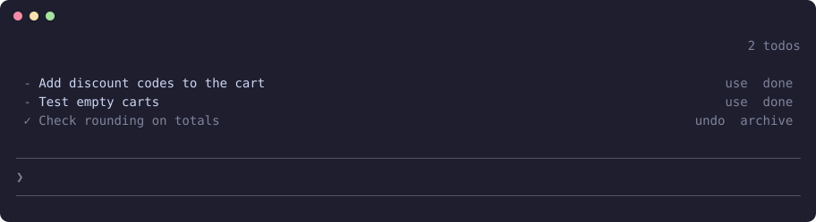

<h1 align="center">claude-todos</h1>

<p align="center"><b>Say "todo" the way you already do. It gets saved, stays on screen, and is there when you ask.</b></p>

<p align="center">
  
  
  
  
</p>

<p align="center"></p>

<p align="center"><sub>Only this mod enabled, in a real terminal session: two open items and one ticked off. The items are a demo list.</sub></p>

"also, todo add an archive chat". "As todo, not now". You say these mid-session, the session may remember, and you forget. This keeps them per project with the count on screen, without changing how you write.

## Install

In a terminal, inside Claude Code:

```
/plugin install todos --marketplace YlitaloJuha/claude-todos
```

Or from a shell:

```bash
claude plugin install todos --marketplace YlitaloJuha/claude-todos
```

In the desktop app, click + next to the prompt box, then Plugins, Add marketplace with `YlitaloJuha/claude-todos`, then Add plugin.

## What it does

- **No special syntax:** A fast model reads only the prompts that mention "todo" or "no action" and pulls out the item, even from "add as todo^^" where it has to look at the reply above.
- **Tick, then archive:** Done keeps an item on the list, ticked. Archive clears it from the screen.
- **Answers "anything left todo?":** When you mention todos, the session gets your real list.
- **Use:** Puts an item in the prompt box, ready to send.
- **Pin:** Shows an item at the top of the list in every session, in any folder. Tick it off in one and it is ticked in all. Unpin moves it to the project you are in.

## Commands

| Command | What it does |
|---|---|
| `/todos` | List this project's todos |
| `/todos show` | Open or close the list above the prompt |
| `/todos add <text>` | Add one by hand |
| `/todos done <n>` | Tick one off |
| `/todos pin <n>` | Show one in every project |
| `/todos unpin <n>` | Move a pinned one to this project |
| `/todos undo` | Reopen the last ticked item |
| `/todos archive` | Clear everything ticked |
| `/todos all` | Open counts for every project, and pinned items |

## What it costs

One Haiku call for each prompt that mentions "todo" or "no action". Other prompts cost nothing.

## What it can reach

No network, no shell commands and no file access through the mod API. The prompt and the end of the last reply go to Haiku through Claude Code, the same provider as your session. Todos are saved as plain text in `~/.claude/plugins/store`, readable only by your user, like your transcripts. Lines that look like a password or common token are dropped, and the list reaches the session as notes, not instructions. Run `claude plugin validate .` in this repository to list every call it makes.

## Limits

- Items only close when you tick them, not when Claude finishes the work.
- Each project has its own list, up to 200 open items, pinned ones included.
- A pinned item's text shows in every project, and reaches those sessions when you mention todos. Do not pin what another project should not see.
- A session already open shows a pinned change on screen after your next prompt or when its turn ends, or when you run `/todos`.
- The secret filter catches common shapes, not everything, so keep real secrets out of your prompts.
- If you write "add as todo^^", the item can repeat text from the reply above. Read it before you press `use`.
- The fast model can misread a prompt. If it cannot answer at all, your first line is saved instead.
- It draws its own count. With [`claude-bars`](https://github.com/YlitaloJuha/claude-bars) installed, the count moves onto that line.
- Claude Code draws the band above the prompt only in the terminal and the desktop app, so what this mod draws there does not show in VS Code or on mobile.

## Develop

```bash
claude plugin validate .
claude plugin test .
claude --plugin-dir .
```

## Make it yours

Once it is loaded, ask your own Claude to fit it to how you work, for example to change which words trigger a capture. The code is in `hooks/register.tsx`, and the license allows changes. Keep your version in a fork, so an update does not replace it. What you change is yours to check.

## Credits

- The "untrusted reply" prompt pattern and small helpers (finding the last reply, pulling JSON out of a model answer, queueing writes) follow [reflect-mod](https://github.com/BayramAnnakov/claude-reflect) by Bayram Annakov (MIT).
- The list of prompt origins no person sent comes from [cache-tax](https://github.com/karanb192/cache-tax) by Karan Bansal (MIT).
- Not related to the other mods named `todos`, such as [dbroadhurst/claude-mod-todos](https://github.com/dbroadhurst/claude-mod-todos).

## Try other mods together

This mod works on its own, and it also works side by side with my other Claude Code mods. See [the full list on my profile](https://github.com/YlitaloJuha/YlitaloJuha#claude-code-mods).

## License and warranty

[MIT](LICENSE). `THIRD_PARTY_LICENSES.md` covers the parts that came from other projects.

Provided **as is, with no warranty of any kind**. You use it at your own risk, and the author is not liable for anything that results from using it, including lost work, usage charges or changes to your code.

**It may break.** It relies on how Claude Code works today, and has been tested on versions 2.1.292 and 2.1.309. It may stop working after a future update if Anthropic changes things.

This is an independent, unofficial project. It is not affiliated with, endorsed by or supported by Anthropic.
